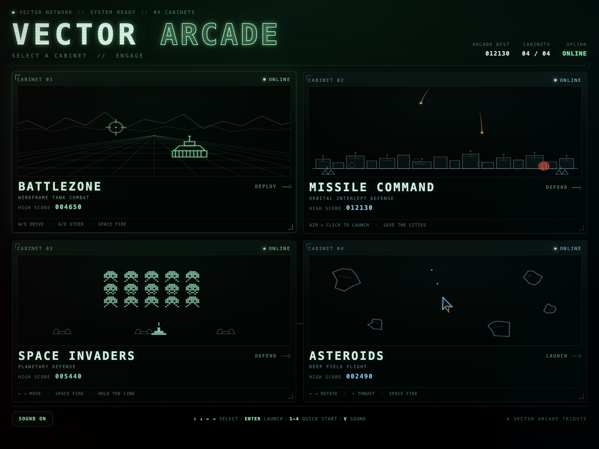

# Vector Arcade



A small collection of self-contained, CRT-style vector arcade games built with plain HTML, CSS, and JavaScript. No build step or dependencies are required.

## Play

Open `index.html` in a browser, or serve the folder locally:

```sh
python3 -m http.server 8000
```

Then visit <http://localhost:8000>.

The launcher lets you pick a game with the mouse or the number keys `1`–`4`.

## Games

| File | Game | Controls |
| --- | --- | --- |
| `battlezone.html` | Battlezone | `W`/`S` drive, `A`/`D` steer, `SPACE` fire |
| `missile-command.html` | Missile Command | Mouse aim, click to launch |
| `space-invaders.html` | Space Invaders | `←`/`→` or `A`/`D` move, `SPACE` fire |
| `asteroids.html` | Asteroids | `←`/`→` rotate, `↑` thrust, `SPACE` fire, `H` hyperspace |

All games support `P` to pause, `R` to restart, and `V` to toggle sound. When a game is launched from the hub, `M` returns to the menu and saves the high score.

## Notes

- Each game is a single standalone HTML file; there is no shared JavaScript bundle.
- High scores are stored in the browser via `localStorage`.
- `index.html` links to the games with `?from=menu`, which enables the in-game **Menu** link and `M` shortcut.

## License

Copyright (C) 2026 Crinklebine.

Licensed under the [GNU General Public License v3.0](LICENSE).
